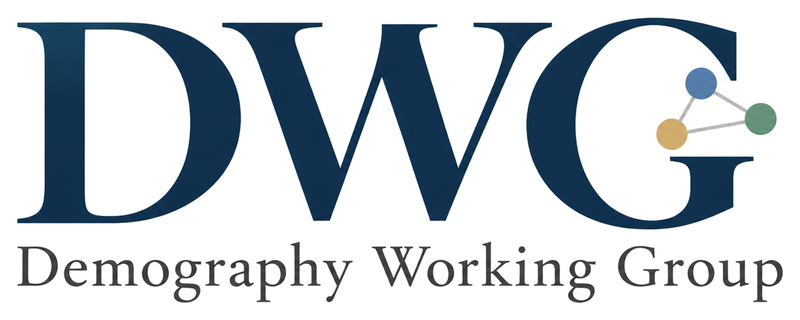

::: {.hero}

[広い意味での人口学に関心を持つ研究者・大学院生が集い、分野の垣根を越えた学際的な研究交流と人的ネットワークの構築を目指す研究会です。]{.lead}

[研究会について](about.qmd){.btn .btn-primary} [参加について](join.qmd){.btn .btn-outline-primary}
:::

## 今後のセミナー



参加を希望される方は「[参加について](join.qmd)」をご覧ください。

## お知らせ

<!-- 最新のお知らせを上に追記してください -->

- **2026年10月21日**　第16回セミナーを開催しました（[記録](seminars/fy2026.qmd#seminar-16)）。

## 主な活動

::: {.grid}
::: {.g-col-12 .g-col-md-4}
::: {.info-card}
### 定期セミナー
東京大学本郷キャンパスにて、メンバーや外部講師による研究報告・議論の場を定期的に開催しています。
:::
:::
::: {.g-col-12 .g-col-md-4}
::: {.info-card}
### 学際的交流
セミナー後の懇親会やオンラインツールを通じて、分野を越えた情報交換を行っています。
:::
:::
::: {.g-col-12 .g-col-md-4}
::: {.info-card}
### 研究ネットワーク
若手研究者・大学院生から実績のある研究者まで、多分野の連携・共同研究を支援します。
:::
:::
:::

## 活動記録

2025年6月の発足以来、ほぼ毎月セミナーを開催しています。

[2026年度の活動記録](seminars/fy2026.qmd){.btn .btn-outline-primary} [2025年度の活動記録](seminars/fy2025.qmd){.btn .btn-outline-primary}
